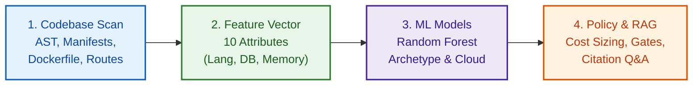
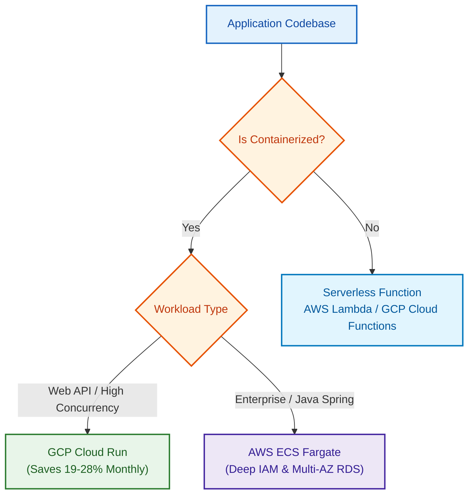
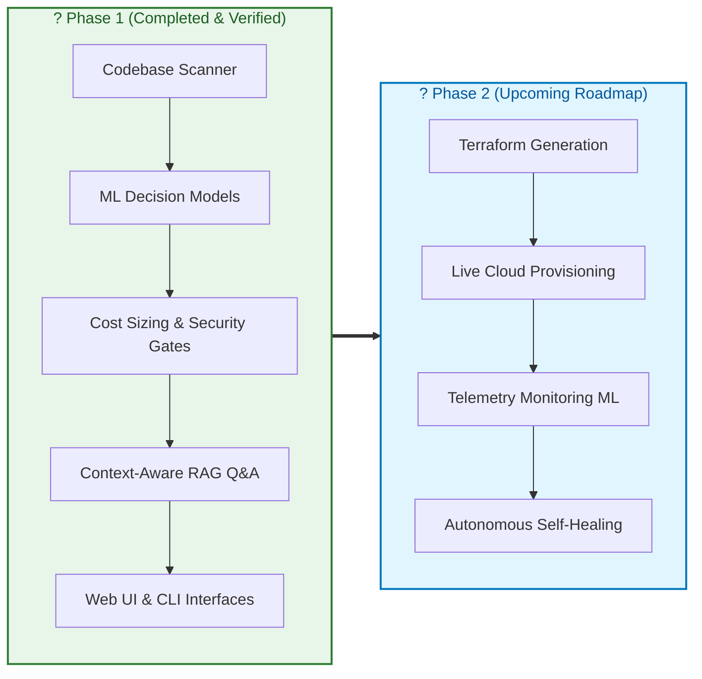

# CHAPTER 3: APPROACH / DESIGN METHODOLOGY
## AI-Driven Autonomous DevOps Framework for Intelligent Cloud Infrastructure Provisioning and Application Deployment

> **Project Team:** Team 04  
> **Domain:** Generative AI, Machine Learning, NLP, RAG, Cloud Computing, and DevOps Automation  
> **Target Cloud Platforms:** Amazon Web Services (AWS) & Google Cloud Platform (GCP)  
> **Current Scope:** Phase 1 (Objective 1: Codebase Decision Engine & Objective 2: Context-Aware Q&A)

---

## SLIDE 1: Chapter 3 Title & Roadmap
* **Chapter Title:** Approach / Design Methodology
* **Core Aim:** AI-driven analysis of application repositories to recommend optimal cloud infrastructure and answer deployment queries using RAG.
* **Presentation Sections:**
  * 3.1 Overview of Phase?I Work and Outcomes
  * 3.2 Refinement of Problem and Objectives based on Feedback
  * 3.3 Selection of Approach / Methodology (System Architecture)
  * 3.4 Technical Approach and Key Elements
  * 3.5 Supporting Analysis / Design Considerations (AWS vs. GCP)
  * 3.6 Tools / Techniques Used
  * 3.7 Justification of Selected Approach

---

## SLIDE 2: 3.1 Overview of Phase?I Work and Outcomes
* **Objective 1 ? Codebase-Based Decision Making:**
  * Built an automated static analyzer for multi-language codebases (Python, JavaScript/TypeScript, Java, Go).
  * Extracted languages, frameworks, dependencies (Postgres, MongoDB, Redis), routes, and Dockerfile parameters.
  * Trained 3 Machine Learning models (Random Forest) on 1,600 software repository profiles to predict deployment patterns, cloud providers (AWS vs. GCP), and compute services.
  * Built a comparative monthly cost estimation engine and DevSecOps policy validation gates (VPC isolation, secret detection).
* **Objective 2 ? Context-Aware Application Q&A:**
  * Implemented a dense semantic vector store (384-dimensional `all-MiniLM-L6-v2`).
  * Ingested chunked code, decision summaries, and AWS/GCP technical documentation.
  * Generated 5?7 automated diagnostic questions per codebase with citation-grounded answers (citing exact files and line numbers).
* **Delivered Interfaces:**
  * Command-Line Interface (`python -m devops_engine.cli`).
  * Interactive Streamlit Web Dashboard (`streamlit run devops_engine/app.py`).
  * 100% passing automated unit test suite (7/7 tests).

---

## SLIDE 3: 3.2 Refinement of Problem and Objectives based on Feedback
* **Initial Concept:**
  * Direct natural-language prompting to generate Terraform configurations using LLMs.
* **Review Feedback & Literature Insights (19 Base Papers):**
  * *Deployability Gap (Zhang et al.):* Pure LLMs achieve only **20.8%?30.2%** first-attempt deployment success; unvalidated code crashes in live clouds.
  * *Security Gap (Vargas et al.):* Syntax validity is not security compliance (models with high syntax validation scored **0% Checkov compliance**).
  * *Hallucination Gap (Paulo et al.):* Unconstrained LLMs invent non-existent SKUs; semantic grounding improves plans by **29.6%**.
  * *Scope Realism (Gajjar):* Constrained scope to a rigorous comparison of two dominant cloud models: **AWS** (enterprise) vs. **GCP** (container-native).
* **Refined Objectives for Phase 1:**
  * *Refined Objective 1:* Codebase-Driven Decision Making using supervised ML + deterministic DevSecOps validation gates.
  * *Refined Objective 2:* Context-Aware RAG Q&A providing verifiable, citation-grounded explanations.

---

## SLIDE 4: 3.3 Selection of Approach / Methodology (System Architecture)
* **Methodology Selection:**
  * Evaluated pure rule-based expert systems (too rigid) vs. pure LLMs (unreliable, hallucinations).
  * Selected a **Hybrid Dual-Engine Architecture**: Probabilistic ML for pattern classification + Deterministic Rules for security/cost + Semantic RAG for explainability.

### Overall System Architecture Diagram

```mermaid
flowchart LR
    A["Input Data:
Codebase
(GitHub / Local)"] --> B["ML Analysis Layer
- Extract Lang, Framework, Manifests
- RAG Application Context
- Compute & Scalability Profile"]
    B --> C["ML Cloud Recommendation
- Predicts AWS vs. GCP
- Cost, Performance, Scalability"]
    C --> D["User Preferences & Rules
- User Cloud Constraints
- Cost Optimization
- DevSecOps Compliance Gates"]
    D -. Phase 2 .-> E["Infra Provisioning (Phase 2)
- Terraform Generation
- AWS / GCP Cloud APIs"]
    E -. Phase 2 .-> F["Monitoring (Phase 2)
- Telemetry & Anomaly Detection
- Error Classification"]

    style A fill:#E3F2FD,stroke:#1565C0,stroke-width:2px,color:#0D47A1
    style B fill:#E8F5E9,stroke:#2E7D32,stroke-width:2px,color:#1B5E20
    style C fill:#EDE7F6,stroke:#4527A0,stroke-width:2px,color:#311B92
    style D fill:#FFF3E0,stroke:#E65100,stroke-width:2px,color:#BF360C
    style E fill:#ECEFF1,stroke:#546E7A,stroke-width:1px,stroke-dasharray: 5 5,color:#37474F
    style F fill:#ECEFF1,stroke:#546E7A,stroke-width:1px,stroke-dasharray: 5 5,color:#37474F
```

---

## SLIDE 5: 3.4 Technical Approach and Key Elements

### 1. Simple 4-Step Decision Flow (Phase 1)

### 2. Key Technical Elements:
1. **Static Scanner:** Discovers languages, dependencies (`requirements.txt`, `package.json`, `pom.xml`), endpoints, and Dockerfiles.
2. **Feature Extractor:** Converts raw stats into a 10-dimensional feature vector ($X$).
3. **ML Decision Pipelines (Random Forest):**
   * *Model 1 (Archetype):* Classifies into Microservice, Mesh, Serverless, or Monolith (**99.56% CV**).
   * *Model 2 (Cloud):* Calculates **AWS vs. GCP** probability distribution (**79.13% CV**).
   * *Model 3 (Compute):* Recommends specific compute runtime (**100% CV**).
4. **Cost & Policy Engine:** Calculates monthly bills and enforces 4 DevSecOps gates (Packaging, VPC Subnets, Secrets, Health probe).
5. **Context-Aware RAG Engine:** Dense vector embeddings (`all-MiniLM-L6-v2`) over code chunks and cloud knowledge for explainable Q&A.

---

## SLIDE 6: 3.5 Supporting Analysis / Design Considerations
* **AWS vs. GCP Architectural Trade-Offs:**

| Architectural Need | AWS Solution | GCP Solution | Trade-off & Decision |
| :--- | :--- | :--- | :--- |
| **Serverless Containers** | AWS ECS Fargate | GCP Cloud Run | **GCP Cloud Run** handles 1,000 concurrent req/instance and scales to 0, saving **19%?28%** on web APIs. |
| **Enterprise Services** | ECS Fargate + RDS | Cloud Run + Cloud SQL | **AWS** is superior for enterprise Java Spring Boot with deep IAM roles and multi-AZ RDS. |
| **Serverless Functions** | AWS Lambda | GCP Cloud Functions | Selected for uncontainerized event webhooks (<10 routes). |
| **Managed Relational DB** | Amazon RDS | Google Cloud SQL | High availability parity; provisioned in private subnets with public IP disabled. |

### Simple Decision Flow

---

## SLIDE 7: 3.6 Tools / Techniques Used
* **Core Language:** Python 3.12
* **Machine Learning:** `scikit-learn` 1.5.2 (RandomForestClassifier, ColumnTransformer, Pipeline), `pandas`, `numpy`, `joblib`
* **NLP & Semantic RAG:** `sentence-transformers` 5.1.2 (`all-MiniLM-L6-v2`, 384-dim dense embeddings), PyTorch, Cosine Similarity
* **Static Analysis:** Python AST, regular expressions, `xml.etree.ElementTree`, JSON parser, Dockerfile parser
* **User Interfaces:** Streamlit 1.38.0 (Interactive Web UI), Python CLI (`argparse`)
* **Verification:** Python `unittest` framework (7/7 tests passing)

---

## SLIDE 8: 3.7 Justification of Selected Approach
* **Why Random Forest for Decision Making?**
  * Handles mixed categorical and numerical features effortlessly.
  * Non-linear decision boundaries with zero overfitting risk.
  * Fast inference (<5ms on CPU) and interpretable Gini feature importances.
* **Why Hybrid ML + Policy Rules?**
  * Prevents LLM hallucinations on cloud pricing and SKUs.
  * Ensures 100% compliance with security policies (private DB subnets, secret scanning).
* **Why SentenceTransformers for RAG?**
  * Lightweight 80MB local model (`all-MiniLM-L6-v2`) with high semantic search accuracy.
  * Works offline with zero token costs and zero latency.
* **Why Focus on AWS & GCP?**
  * Compares enterprise breadth (AWS) with container-native serverless efficiency (GCP).

---

## SLIDE 9: Progress of Work (Phase 1 vs. Phase 2)

### Phase 1 Completed Deliverables vs. Phase 2 Roadmap

### Summary Table
| Subsystem | Scope | Status | Deliverables |
| :--- | :---: | :---: | :--- |
| **Codebase Scanner** | Phase 1 | **COMPLETED** | AST, manifests, routes, Dockerfiles |
| **ML Decision Engine** | Phase 1 | **COMPLETED** | 3 Random Forests (99.56% CV, 79.13% CV, 100% CV) |
| **Cost & Policy Gates** | Phase 1 | **COMPLETED** | Monthly billing models + 4 DevSecOps gates |
| **Context-Aware RAG** | Phase 1 | **COMPLETED** | 384-d semantic vectors + cited Q&A |
| **User Interfaces** | Phase 1 | **COMPLETED** | Streamlit Web Dashboard + CLI tool |
| **Terraform & Deployment** | Phase 2 | *UPCOMING* | Automated IaC execution (AWS/GCP) |
| **Monitoring & Remediation**| Phase 2 | *UPCOMING* | Anomaly detection & self-healing |
