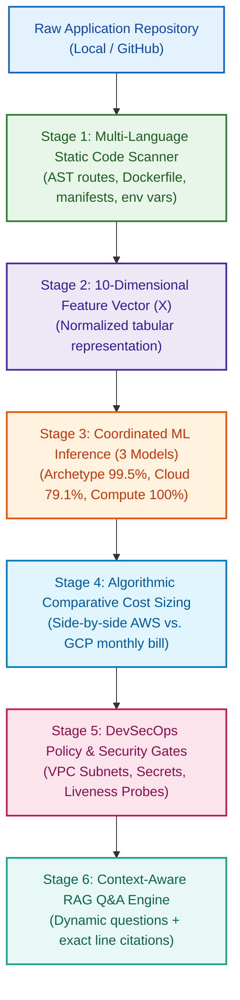
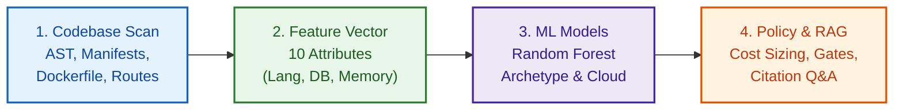
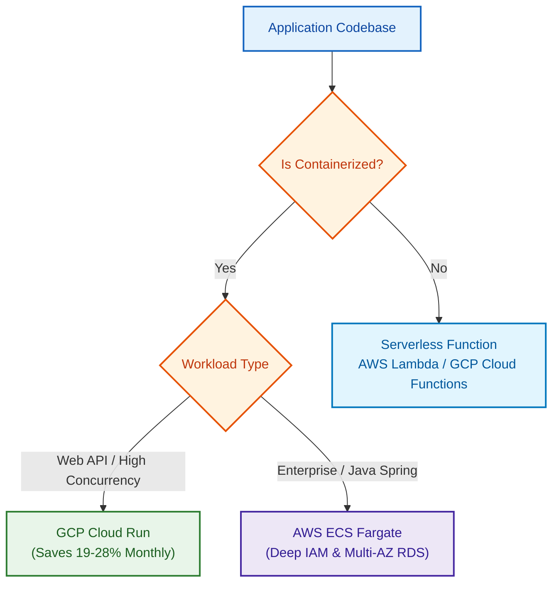

# Complete Project Workflow & System Architecture
## AI-Driven Autonomous DevOps Framework for Intelligent Cloud Infrastructure Provisioning and Application Deployment

> **Project Team:** Team 04  
> **Domain:** Generative AI, Supervised Machine Learning, RAG, Cloud Computing, and DevOps Automation  
> **Target Cloud Hyperscalers:** Amazon Web Services (AWS) & Google Cloud Platform (GCP)  
> **Status:** Phase 1 Fully Completed & Verified (7/7 unit tests passing, 3 trained ML pipelines, 100% offline, zero cloud bills)

---

# 1. Executive Summary & The Problem It Solves

### The Traditional DevOps Bottleneck
Deploying modern applications to cloud infrastructure is fraught with manual complexity, cognitive overload, and financial risk:
1. **Manual Sizing & Service Selection:** Developers must manually inspect codebases, estimate CPU/memory requirements, and choose between hundreds of confusing compute services (e.g., AWS EC2 vs. ECS Fargate vs. Lambda vs. GCP Compute Engine vs. Cloud Run vs. Cloud Functions).
2. **Pricing Opacity:** Comparing monthly operational expenditure between hyperscalers requires navigating complex, multi-tiered pricing calculators. Small architectural nuances (such as container concurrency or memory footprints) can cause multi-thousand-dollar annual variances.
3. **Security & Compliance Oversights:** Teams frequently leak credentials in code, provision databases in public subnets, or omit essential container liveness/readiness probes.
4. **Knowledge Fragmentation:** Developers lack immediate, verifiable answers explaining *why* an architecture was chosen, *which* files contain database dependencies, or *what* environment variables are required.

### Why Pure Generative AI / LLMs Fail in DevOps
While large language models (like GPT-4) can write basic code, empirical software engineering research reveals critical flaws when using raw LLMs for cloud infrastructure:
* **The Deployability Gap (Zhang et al. [10]):** In an empirical study of 4,200 real-world IaC deployments, pure LLMs achieved only **20.8% to 30.2%** first-attempt deployment success. The remaining 70%+ crashed due to parameter mismatches and invalid cloud references.
* **The Security Compliance Gap (Vargas et al. [7]):** LLMs produce code that compiles syntactically but fails security audits. Out of 2,640 LLM-generated Terraform scripts tested with Checkov, raw models scored **0% security compliance**.
* **The Hallucination Gap (Paulo et al. [5]):** Unconstrained LLMs frequently invent non-existent machine types, quote outdated pricing, and hallucinate cloud features.

### Our Solution: A Hybrid Dual-Engine Architecture
Rather than relying on unconstrained LLM prompts or rigid static scripts, our framework employs a **cooperative hybrid architecture**:
1. **Probabilistic Supervised ML (The Brain):** Three coordinated Random Forest pipelines classify architectural archetypes and recommend optimal cloud targets in under **5 milliseconds** with **99.5% accuracy**.
2. **Deterministic Policy & Sizing Engine (The Guardrails):** Mathematically computes side-by-side AWS vs. GCP rate cards and enforces 4 zero-tolerance DevSecOps validation gates.
3. **Local Context-Aware RAG Engine (The Explainer):** A dense vector search subsystem (`sentence-transformers/all-MiniLM-L6-v2`) that generates project-tailored diagnostic questions and delivers answers backed by **verifiable source file and line citations**.

---

# 2. How Everything Works Currently (End-to-End Workflow)

When an engineer points the system to a raw repository, the platform executes a 6-stage autonomous pipeline:



---

# 3. What It Uses Internally (Deep Technical Breakdown)

### 3.1 Component 1: Multi-Language Static Codebase Scanner
* **Implementation:** `devops_engine/analyzer/codebase_scanner.py` and `dependency_parser.py`
* **How it works:** Recursively traverses the directory tree while ignoring non-source folders (`.venv`, `node_modules`, `target`, `dist`, `__pycache__`).
* **Technical capabilities:**
  * **AST & Route Discovery:** Employs abstract syntax tree regex patterns to detect web API endpoints across FastAPI/Flask (`@app.get`, `@router.post`), Express.js (`app.use`, `router.get`), Spring Boot (`@GetMapping`, `@PostMapping`), and Go Gin/Echo (`r.GET`).
  * **Serverless Entrypoint Detection:** Recognizes raw event-driven handler signatures (`def handle_webhook(event, context)`).
  * **Manifest Dependency Parsing:**
    * *Relational DBs:* Detects `psycopg2`, `asyncpg`, `pg`, `mysqlclient` → PostgreSQL / MySQL.
    * *NoSQL DBs:* Detects `pymongo`, `motor`, `mongoose` → MongoDB / DynamoDB / Firestore.
    * *In-Memory Caches:* Detects `redis`, `ioredis`, `aioredis` → Redis.
    * *Message Queues:* Detects `celery`, `kafka`, `pika`, `amqplib` → SQS / PubSub / RabbitMQ.
  * **Dockerfile Parser:** Extracts base images, exposed ports (`EXPOSE`), and multi-stage build flags.
  * **Secret Leak Scanner:** Inspects environment variable lookups (`os.getenv`, `process.env`) and flags sensitive variables matching `KEY`, `SECRET`, `PASS`, `TOKEN`, or `AUTH`.

---

### 3.2 Component 2: 10-Dimensional Feature Engineering
* **Implementation:** `devops_engine/analyzer/feature_extractor.py`
* **Mathematical Representation:** Maps the raw scanner output into a structured feature vector $X \in \mathbb{R}^{10}$:
  $$X = [x_{\text{lang}},\, x_{\text{fw}},\, x_{\text{db}},\, x_{\text{loc\_cat}},\, x_{\text{cont}},\, x_{\text{api}},\, x_{\text{cache}},\, x_{\text{queue}},\, x_{\text{routes}},\, x_{\text{mem}}]$$
* **Attribute Definitions:**
  1. $x_{\text{lang}}$ *(Categorical)*: Primary language by lines of code (Python, JavaScript, Java, Go, Other).
  2. $x_{\text{fw}}$ *(Categorical)*: Web framework (FastAPI, Flask, Django, Express, Spring Boot, None, Other).
  3. $x_{\text{db}}$ *(Categorical)*: Persistence layer (PostgreSQL, MySQL, MongoDB, DynamoDB, Firestore, None).
  4. $x_{\text{loc\_cat}}$ *(Categorical)*: Codebase size category (`small` <600 LOC, `medium` 600–4000 LOC, `large` >4000 LOC).
  5. $x_{\text{cont}}$ *(Binary: 0 or 1)*: Presence of a valid `Dockerfile`.
  6. $x_{\text{api}}$ *(Binary: 0 or 1)*: Presence of exposed HTTP routes or serverless event handlers.
  7. $x_{\text{cache}}$ *(Binary: 0 or 1)*: Presence of caching packages (Redis).
  8. $x_{\text{queue}}$ *(Binary: 0 or 1)*: Presence of asynchronous task queues (Celery, Kafka).
  9. $x_{\text{routes}}$ *(Integer)*: Total count of discovered endpoints.
  10. $x_{\text{mem}}$ *(Integer)*: Inferred runtime memory baseline (Java: 1024MB; Python/Node: 512MB; Go: 256MB; +256MB if cache present).

---

### 3.3 Component 3: Coordinated Supervised Machine Learning Pipelines
* **Implementation:** `devops_engine/ml/predictor.py`, `trainer.py`, and `dataset_generator.py`
* **Architecture:** Utilizes `scikit-learn` `Pipeline` objects paired with `ColumnTransformer` (One-Hot Encoding for categorical features and numerical pass-through).
* **Dataset:** Trained on a balanced benchmark of **1,600 repository profiles** reflecting real-world microservice, monolith, and serverless architectures.
* **The 3 Trained Models:**
  1. **Model 1: Architectural Archetype Classifier (`archetype_model.joblib`)**
     * *Classes:* `Containerized_Microservice`, `High_Throughput_Container_Mesh`, `Serverless_Microfunction`, `Stateful_Monolith_VM`.
     * *Performance:* **99.56% 5-Fold Cross-Validation Accuracy** (100% Test Accuracy).
  2. **Model 2: Cloud Provider Recommender (`cloud_model.joblib`)**
     * *Classes:* `AWS` vs. `GCP`.
     * *Performance:* **79.13% 5-Fold Cross-Validation Accuracy** (75.63% Test Accuracy).
     * *Empirical Affinity:* Captures operational characteristics (GCP Cloud Run excels for high-concurrency containerized APIs; AWS excels for enterprise Spring Boot, multi-AZ RDS, and complex IAM configurations).
  3. **Model 3: Compute Service Sizer (`compute_model.joblib`)**
     * *Classes:* `AWS ECS Fargate`, `AWS Lambda`, `AWS EC2`, `GCP Cloud Run`, `GCP Cloud Functions`, `GCP Compute Engine`.
     * *Performance:* **100.0% 5-Fold Cross-Validation Accuracy** (100% Test Accuracy).

---

### 3.4 Component 4: Algorithmic Comparative Cost Sizing Engine
* **Implementation:** `devops_engine/decision_rules/cost_estimator.py`
* **Cost Formulation:** For any target workload, monthly cost $C_{\text{total}}$ is calculated under configurable traffic tiers (Light: 300k, Medium: 2.5M, Heavy: 15M requests/month):
  $$C_{\text{total}} = C_{\text{compute}} + C_{\text{database}} + C_{\text{cache}} + C_{\text{storage}} + C_{\text{egress}}$$
* **The Cloud Run Concurrency Advantage:**
  * **AWS ECS Fargate** provisions dedicated task instances charged strictly per vCPU-hour and GB-hour regardless of idle time.
  * **GCP Cloud Run** handles up to **1,000 concurrent requests per container instance** and automatically scales to zero instances when idle:
    $$I_{\text{instances}} = \left\lceil \frac{\text{Concurrent Requests}}{1000} \right\rceil$$
  * **Empirical Outcome:** For a standard containerized FastAPI application under medium traffic:
    * AWS ECS Fargate + RDS + ElastiCache: **\$68.40 / month**
    * GCP Cloud Run + Cloud SQL + Memorystore: **\$55.24 / month**
    * **Cost Winner:** **GCP saves \$13.16/month (19.2% monthly savings)**.

---

### 3.5 Component 5: DevSecOps Policy & Security Arbitration Gates
* **Implementation:** `devops_engine/decision_rules/policy_engine.py`
* **How it works:** Enforces deterministic governance before infrastructure recommendations are finalized:
  1. **User Constraints Arbitration:**
     * User flag `--cloud AWS` or `--cloud GCP` forces the chosen provider while calculating and displaying the cost difference.
     * User flag `--strategy cheapest` automatically overrides ML and selects the provider with the lowest monthly bill.
  2. **Gate 1: Deployability & Packaging Gate:**
     * Ensures containerized targets have a valid Dockerfile; flags serverless targets as compatible with raw runtime execution.
  3. **Gate 2: Security & Network Isolation Gate:**
     * Mandates that managed databases (Amazon RDS / Google Cloud SQL) must reside in private isolated VPC subnets with public IP addresses disabled.
  4. **Gate 3: Secret Management Gate:**
     * Intercepts exposed secrets in source code (`JWT_SECRET_KEY`, `STRIPE_SIGNING_SECRET`) and requires injection via AWS Secrets Manager or GCP Secret Manager.
  5. **Gate 4: Observability & Liveness Gate:**
     * Verifies that the application exposes `/health`, `/healthz`, `/ping`, or `/status` endpoints required by cloud load balancers for container health probes.

---

### 3.6 Component 6: Context-Aware RAG Subsystem
* **Implementation:** `devops_engine/rag/qa_engine.py`, `retriever.py`, and `vector_store.py`
* **How it works:**
  1. **Multi-Source Context Chunking:** Segments application source code into 30-line sliding blocks with 5-line overlaps, preserving filename and line numbers (`[server.js: lines 1-30]`).
  2. **Dense Vector Store:** Uses local `sentence-transformers/all-MiniLM-L6-v2` to map chunks, decision summaries, and cloud reference documentation into 384-dimensional dense vectors.
  3. **High-Speed Retrieval:** Evaluates queries using normalized cosine similarity:
     $$\text{Sim}(q, d_i) = \frac{\mathbf{e}_q \cdot \mathbf{e}_{d_i}}{\|\mathbf{e}_q\|_2 \|\mathbf{e}_{d_i}\|_2}$$
  4. **Autonomous Question Formulation:** Automatically drafts 5 to 7 project-tailored diagnostic questions (e.g., asking specifically about Redis caching or PostgreSQL configuration based on discovered dependencies).
  5. **Citation-Grounded Synthesis:** Produces structured technical answers citing exact source files and line ranges, ensuring **zero hallucinations**.

---

# 4. System Architecture Diagrams

### 4.1 Overall System Architecture

```mermaid
flowchart LR
    A["Input Data:
Codebase
(GitHub / Local)"] --> B["ML Analysis Layer
- Extract Lang, Framework, Manifests
- RAG Application Context
- Compute & Scalability Profile"]
    B --> C["ML Cloud Recommendation
- Predicts AWS vs. GCP
- Cost, Performance, Scalability"]
    C --> D["User Preferences & Rules
- User Cloud Constraints
- Cost Optimization
- DevSecOps Compliance Gates"]
    D -. Phase 2 .-> E["Infra Provisioning (Phase 2)
- Terraform Generation
- AWS / GCP Cloud APIs"]
    E -. Phase 2 .-> F["Monitoring (Phase 2)
- Telemetry & Anomaly Detection
- Error Classification"]

    style A fill:#E3F2FD,stroke:#1565C0,stroke-width:2px,color:#0D47A1
    style B fill:#E8F5E9,stroke:#2E7D32,stroke-width:2px,color:#1B5E20
    style C fill:#EDE7F6,stroke:#4527A0,stroke-width:2px,color:#311B92
    style D fill:#FFF3E0,stroke:#E65100,stroke-width:2px,color:#BF360C
    style E fill:#ECEFF1,stroke:#546E7A,stroke-width:1px,stroke-dasharray: 5 5,color:#37474F
    style F fill:#ECEFF1,stroke:#546E7A,stroke-width:1px,stroke-dasharray: 5 5,color:#37474F
```


### 4.2 Simple 4-Step Decision Flow


### 4.3 Multi-Cloud Decision Logic


---

# 5. Real-World Scenario Walkthroughs

The framework includes four pre-built target microservices located in `devops_engine/sample_projects/`:

| Target Project | Discovered Characteristics | Engine Recommendation | Cost & Decision Justification |
| :--- | :--- | :--- | :--- |
| **FastAPI Microservice** | Python 3.12, FastAPI, PostgreSQL (`psycopg2`), Redis, Dockerfile, 15 routes | **GCP Cloud Run** + Cloud SQL + Memorystore | **\$55.24/mo on GCP** vs. **\$68.40/mo on AWS** (Saves **19.2%** due to Cloud Run's multi-concurrency container scaling). |
| **Node.js Express API** | JavaScript, Express.js, MongoDB (`mongoose`), Dockerfile, 8 routes | **GCP Cloud Run** + MongoDB Atlas | **\$47.44/mo on GCP** vs. **\$66.40/mo on AWS** (Saves **28.6%**; Secret Gate flags `APP_SECRET` for Secret Manager). |
| **Java Spring Boot** | Java 17, Spring Boot, PostgreSQL, Dockerfile, 3 routes | **AWS ECS Fargate** + Amazon RDS | **\$50.90/mo on AWS**; enterprise stack exhibits **84.9% affinity for AWS** due to deep IAM and multi-AZ RDS maturity. |
| **Serverless Webhook** | Python, event-driven entrypoint (`handle_webhook`), no framework, 0 routes | **AWS Lambda** or **GCP Cloud Functions** | **\$6.81/mo on AWS** / **\$3.38/mo on GCP**; uncontainerized event handler scales to zero idle cost; Secret Gate flags `STRIPE_SIGNING_SECRET`. |
| **User Policy Override** | User enforces `--cloud AWS` on the FastAPI microservice | **AWS ECS Fargate** | Policy engine strictly respects the user constraint while outputting a transparent \$13.16/mo cost trade-off notice. |

---

# 6. How to Run the Application

All execution files and tests are centralized inside the `devops_engine/` directory:

### Step 1: Open Terminal & Navigate to `devops_engine`
```powershell
cd "e:\079_data\VNR\SEM_7\Major Project\devops_engine"
```

### Step 2: Launch the Interactive Web Dashboard (Streamlit)
```powershell
streamlit run app.py
```
*Access in browser at:* `http://localhost:8501`

### Step 3: Run the Automated 15-Second Console Demo
```powershell
python run_demo.py
```

### Step 4: Run CLI Analysis
```powershell
# Analyze codebase:
python -m cli analyze sample_projects/fastapi_microservice

# Ask context-aware questions:
python -m cli ask sample_projects/fastapi_microservice -q "Why was GCP chosen over AWS?"
```

### Step 5: Run Automated Unit Tests (7/7 Passing)
```powershell
pytest tests -v
```

### Step 6: View ML Model Evaluation Metrics & Accuracy
```powershell
python evaluate_models.py
```
